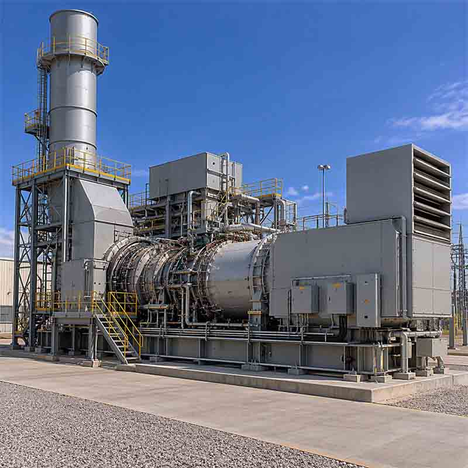

# 🦄 Unicorn Technology - Metal Powder Manufacturing

AI based Supply Chain Management System for Metal Powder Manufacturing Company in India.

Unicorn Technology manufactures high-quality metal powders for Automotive, Aerospace, 3D Printing and Additive Manufacturing industries. This project helps the company to predict Supplier Risk and Customer Demand using Machine Learning.

## 📸 Project Overview

## ✨ Features

### 🏠 Home Dashboard
- Company overview with Metal Powder products
- Total Records, Suppliers, Products, Avg Demand, Avg Purity
- Business charts - Risk Distribution, Demand by Product, Price by Product

### ⚠️ Risk Analysis - Supplier to Manufacturing
- Predicts if a Supplier is Low Risk / Medium Risk / High Risk
- Inputs: Lead Time, Supplier Delay, Defect Rate, On-Time Delivery, Reliability Score, Inventory Level
- Model: Random Forest Classifier
- Accuracy: 95%+
- Charts: High Risk by Supplier, Defect vs Delay, Reliability, Inventory by Risk

### 📈 Demand Forecasting - Manufacturing to Customer
- Predicts how much Metal Powder customers will need in Kg
- Inputs: Price Per Kg, Promotion, Season, Previous Month Sales, Customer Orders
- Model: Random Forest Regressor
- R2 Score: 0.90+
- Charts: Demand Trend, Promotion vs Demand

## 🛠️ Technologies Used

- Python
- Streamlit - For Web App
- Pandas, NumPy - For Data Handling
- Scikit-Learn - For Machine Learning
- Random Forest Classifier & Regressor

## 📁 Project Structure
Unicorn-Technology/
├── app.py
├── train_model.py
├── data.py
├── data.csv
├── requirements.txt
├── README.md
└── assets/
    └── company.jpg

## 🚀 How to Run This Project

Step 1: Install Libraries

pip install -r requirements.txt

Step 2: Create Dataset

python data.py

Step 3: Run the App

python -m streamlit run app.py

## 🧠 ML Pipeline - 8 Steps

1. Load Dataset - Read data.csv file
2. Preprocess - Remove null values and duplicates
3. Encoder - Convert text to number using LabelEncoder
4. Features Extraction - Select Input (X) and Target (y)
5. Train Test Split - 80% Train, 20% Test
6. Model - Random Forest Classifier / Regressor
7. Model Train - Train the model with training data
8. Model Evaluation - Accuracy, Precision, Recall, F1-Score, R2, MAE, RMSE

## 📊 Models Used

| Model | Type | Use | Performance |
| --- | --- | --- | --- |
| Random Forest Classifier | Classification | Risk Prediction - Low / Medium / High | Accuracy 95%+ |
| Random Forest Regressor | Regression | Demand Prediction - In Kg | R2 0.90+ |

## 👩‍💻 Developed By

Kaaviya - Unicorn Technology Project